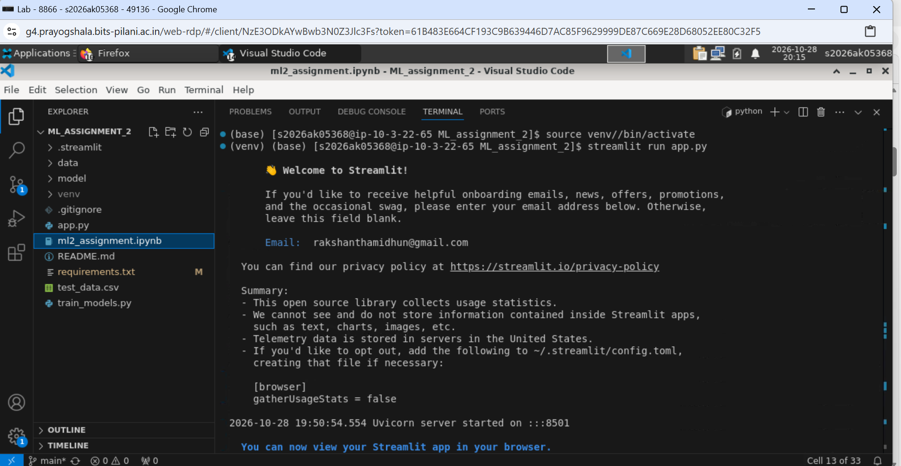
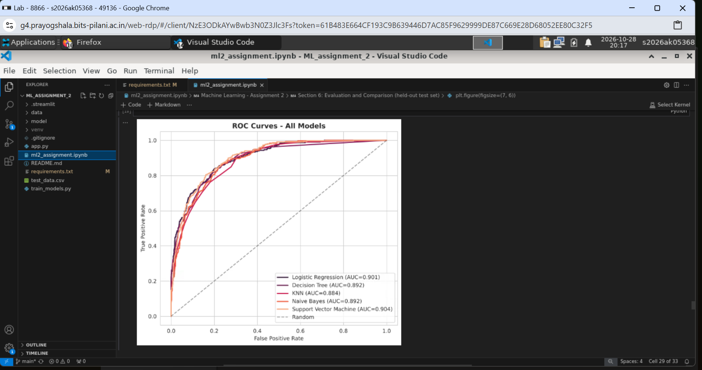
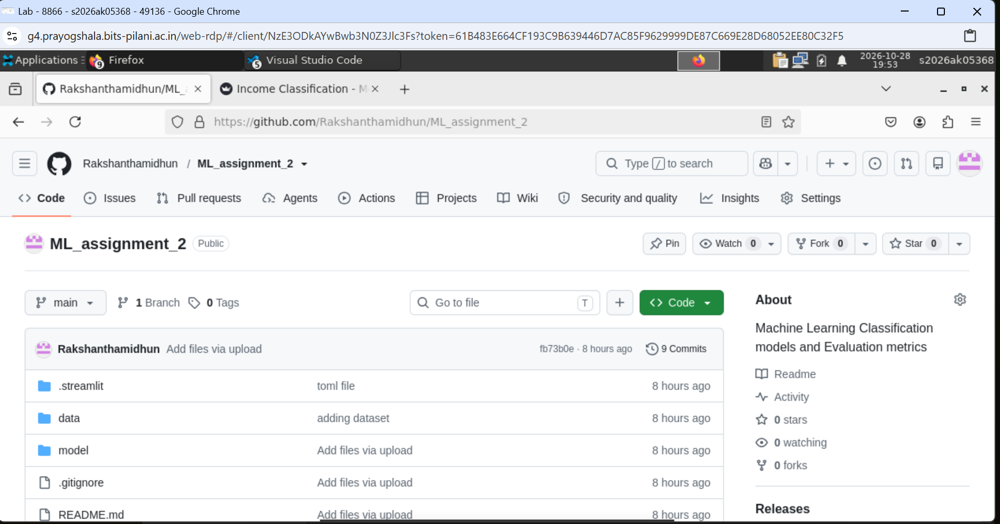
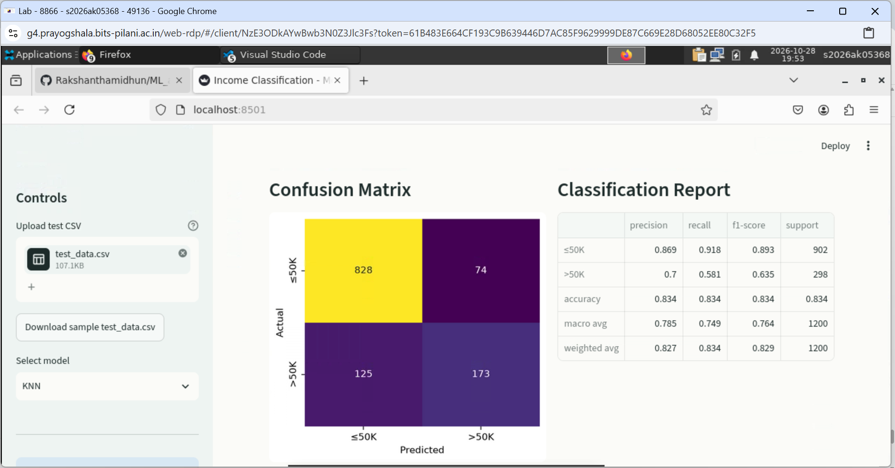
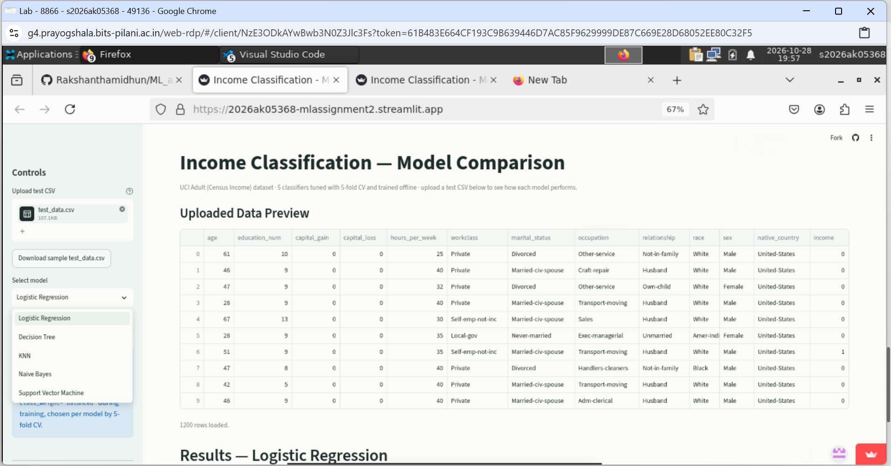
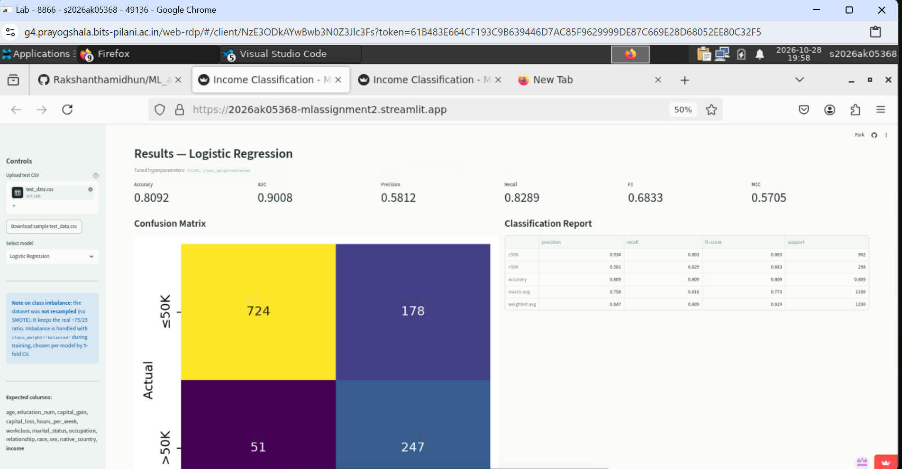
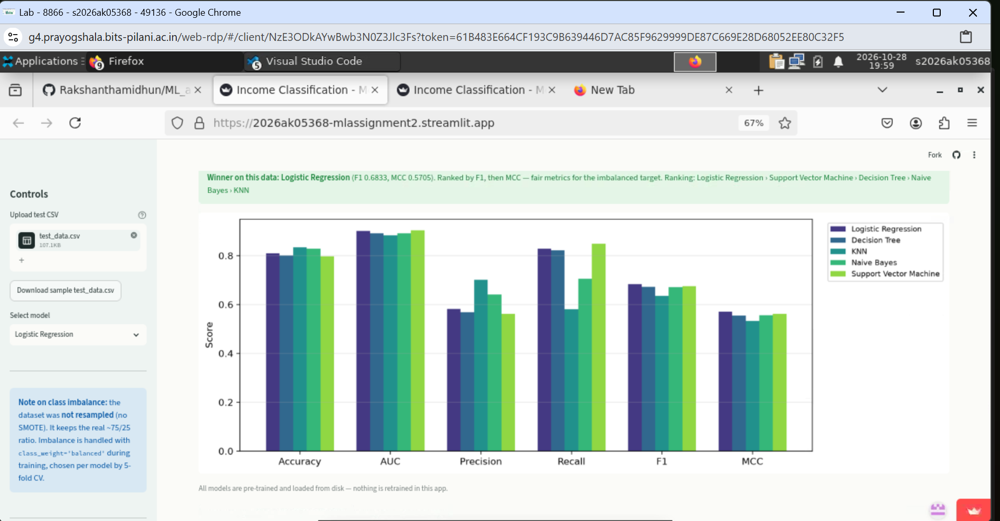
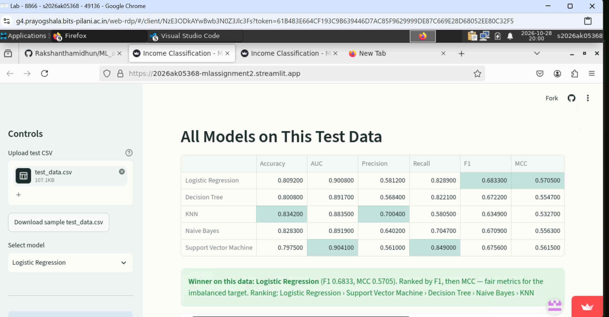

# Income Classification — Model Comparison (ML Assignment 2)

**Student:** RAKSHANTHA M 
**Course:** M.Tech AIML, BITS Pilani WILP  
**BITS ID:** 2026AK05368

> [!NOTE]
> **Class imbalance handling: the dataset was NOT resampled.**
> - **Data:** no SMOTE, no over- or under-sampling. Train and test both keep the real ~75% `≤50K` / ~25% `>50K` ratio.
> - **Training:** imbalance is handled with **class weighting** (`class_weight='balanced'`). Errors on the minority class cost ~3× more, with no rows added or removed.
> - **Per model:** weighting is a tuned hyperparameter. 5-fold CV picked **balanced** for LR, Decision Tree and SVM, and **natural** for Naive Bayes, where 50/50 priors scored worse. KNN has no weighting option.
> - **Why not SMOTE:** a 3:1 imbalance is moderate; synthetic one-hot rows are unrealistic; it would add `imbalanced-learn` to the app.
> - **Selection metric:** F1, not accuracy. Predicting `≤50K` for everyone already scores 75% accuracy.

## 1. Problem Statement

This project predicts whether an individual's annual income exceeds $50,000 based
on demographic and employment attributes recorded in a census survey. This is a
binary classification problem with practical relevance to socioeconomic research,
targeted public policy, and resource allocation — organizations and governments
routinely need to estimate income brackets from easily observable attributes
(age, occupation, education, marital status, hours worked, etc.) when direct
income data isn't available or is self-reported unreliably. The goal of this
assignment is to build, compare, and evaluate five different classification
algorithms on this task, tune each one's hyperparameters with cross-validation, decide how to handle
the dataset's class imbalance (roughly 75% low-income / 25% high-income),
identify which model generalizes best, and deploy
the best-performing pipeline as an interactive web app that scores new data
without retraining.

## 2. Dataset Description

- **Name:** UCI Adult (Census Income) Dataset
- **Source:** UCI Machine Learning Repository, retrieved via a public GitHub
  mirror of the UCI dataset (`jbrownlee/Datasets/adult-all.csv`), which hosts the
  dataset's canonical CSV form unmodified from the original UCI release.
- **Original size:** 48,842 instances, 14 raw attributes + 1 target
- **Used in this project:** a stratified subsample of 6,000 instances (to keep
  SVM training tractable and the repo lightweight for Streamlit Community
  Cloud's free tier), split 80/20 into train (4,800) and test (1,200), both
  stratified on the target to preserve class balance.
- **Target:** `income` — binarized to 1 if `>50K`, 0 if `<=50K`
- **Features used (12, after cleaning):** `age`, `education_num`,
  `capital_gain`, `capital_loss`, `hours_per_week` (numeric), and `workclass`,
  `marital_status`, `occupation`, `relationship`, `race`, `sex`,
  `native_country` (categorical).
- **Dropped from the original 14 raw columns:** `fnlwgt` (a census sampling
  weight, not a predictive feature) and `education` (a redundant string
  duplicate of the already-retained ordinal `education_num`).
- **Preprocessing:** rows with missing `workclass`/`occupation` dropped;
  `native_country` collapsed to `United-States` vs `Other` (90%+ of rows are
  `United-States`, and the long tail of ~40 other countries has too few rows
  each to be informative); numeric features standardized; categorical features
  one-hot encoded (`drop='first'`, unknown categories handled gracefully).

- **Class imbalance:** 75.2% `≤50K` vs 24.8% `>50K` (3:1). The data is **not
  resampled** and the test set keeps the real-world ratio. Instead, cost-sensitive
  class weighting (`class_weight='balanced'` for LR/DT/SVM, 50/50 `priors` for
  Naive Bayes) is included as a hyperparameter, and 5-fold CV decides per model
  whether it helps. SMOTE was rejected: at 3:1 it isn't needed, it synthesises
  artificial one-hot rows, and it would add `imbalanced-learn` as an app dependency.

This satisfies the assignment's requirements of ≥500 instances (6,000 used),
≥12 features (exactly 12 after deliberate, justified feature engineering), and
a binary target sourced from UCI.

## 3. GitHub Repository
**GitHub repo link:** [https://github.com/Rakshanthamidhun/ML_assignment_2]

The repository contains the complete source code (`app.py`, `train_models.py`,
`ml2_assignment.ipynb`), `requirements.txt`, this README, the test data
(`test_data.csv`) and the five saved models in `model/`.

## 4. Models Used and Comparison

### Hyperparameter tuning

Every model is a `Pipeline(ColumnTransformer preprocessing + classifier)` tuned with
`GridSearchCV` using **5-fold stratified cross-validation on the 4,800-row training set
only**. Each combination is scored on F1, MCC, AUC, Accuracy, Precision and Recall, and
the best is refitted by **F1** (positive class), because accuracy rewards predicting the
majority class (an "always `≤50K`" baseline already scores 75.2%). Preprocessing sits
inside the pipeline, so scaling and encoding are refitted per fold with no leakage.

| Model | Grid searched | Best (selected by CV F1) |
|---|---|---|
| Logistic Regression | `C` ∈ {0.01, 0.1, 1, 10, 100}, `class_weight` ∈ {None, balanced} | `C=100`, `class_weight=balanced` |
| Decision Tree | `max_depth` ∈ {4, 6, 8, 10, 12, None}, `min_samples_leaf` ∈ {1, 5, 10, 20}, `criterion` ∈ {gini, entropy}, `class_weight` | `entropy`, `max_depth=None`, `min_samples_leaf=20`, `balanced` |
| KNN | `n_neighbors` ∈ {5, 11, 15, 21, 31, 41}, `weights` ∈ {uniform, distance}, `p` ∈ {1, 2} | `n_neighbors=21`, `uniform`, `p=2` |
| Naive Bayes (Gaussian) | `var_smoothing` ∈ 10⁻⁹ … 10⁰ (10 values), `priors` ∈ {natural, 50/50} | `var_smoothing=0.1`, natural priors |
| SVM (RBF) | `C` ∈ {0.1, 1, 10}, `gamma` ∈ {scale, 0.01, 0.1}, `class_weight` | `C=1`, `gamma=scale`, `balanced` |

### Comparison table (1,200-row held-out test set)

All six metrics computed with `sklearn.metrics` on the untouched test split.

| ML Model Name | Accuracy | AUC | Precision | Recall | F1 | MCC |
|---|---|---|---|---|---|---|
| Logistic Regression | 0.8092 | 0.9008 | 0.5812 | 0.8289 | **0.6833** | **0.5705** |
| Decision Tree | 0.8008 | 0.8917 | 0.5684 | 0.8221 | 0.6722 | 0.5547 |
| KNN | **0.8342** | 0.8837 | **0.6988** | 0.5839 | 0.6362 | 0.5335 |
| Naive Bayes | 0.8283 | 0.8919 | 0.6402 | 0.7047 | 0.6709 | 0.5563 |
| Support Vector Machine | 0.7975 | **0.9041** | 0.5610 | **0.8490** | 0.6756 | 0.5615 |

*(Bold = best value per metric.)*

### Should the dataset be balanced? (CV evidence, training data only)

Best configuration with vs without class weighting, 5-fold CV means:

| Model | Weighting | CV Accuracy | CV AUC | CV Recall | CV F1 | CV MCC |
|---|---|---|---|---|---|---|
| Logistic Regression | natural | 0.8473 | 0.9015 | 0.5995 | 0.6608 | 0.5686 |
| Logistic Regression | **balanced** | 0.8117 | 0.9016 | 0.8312 | **0.6865** | **0.5754** |
| Decision Tree | natural | 0.8419 | 0.8724 | 0.5886 | 0.6483 | 0.5534 |
| Decision Tree | **balanced** | 0.8069 | 0.8854 | 0.8253 | **0.6795** | **0.5654** |
| Naive Bayes | **natural** | 0.8285 | 0.8881 | 0.7112 | **0.6730** | **0.5589** |
| Naive Bayes | 50/50 priors | 0.7933 | 0.8881 | 0.8337 | 0.6670 | 0.5486 |
| SVM | natural | 0.8429 | 0.8838 | 0.6146 | 0.6601 | 0.5614 |
| SVM | **balanced** | 0.8031 | 0.8996 | 0.8472 | **0.6811** | **0.5691** |

> [!IMPORTANT]
> **The dataset itself was not balanced.** The rows stay at the natural 75/25 ratio. The *training* was balanced through class weights, chosen per model by cross-validation.

**Verdict:** keep the data unbalanced (no resampling) and use class weighting where CV
shows it helps. For LR, DT and SVM, balanced weights raise minority-class recall from
~0.60 to ~0.83 and improve F1 by 2–3 points and MCC slightly, at the cost of ~3–4 points
of accuracy, which is the expected trade-off. AUC is essentially unchanged because
weighting shifts the decision threshold rather than improving ranking. For Naive Bayes,
50/50 priors hurt, so natural priors were kept. KNN has no weighting option.

### Effect of tuning (test set, before → after)

| Model | F1 | MCC | AUC | Recall |
|---|---|---|---|---|
| Logistic Regression | 0.6617 → 0.6833 | 0.5724 → 0.5705 | 0.8995 → 0.9008 | 0.5940 → 0.8289 |
| Decision Tree | 0.6492 → 0.6722 | 0.5572 → 0.5547 | 0.8697 → 0.8917 | 0.5805 → 0.8221 |
| KNN | 0.6165 → 0.6362 | 0.5088 → 0.5335 | 0.8819 → 0.8837 | 0.5638 → 0.5839 |
| Naive Bayes | 0.5843 → 0.6709 | 0.4435 → 0.5563 | 0.8676 → 0.8919 | 0.9128 → 0.7047 |
| Support Vector Machine | 0.6433 → 0.6756 | 0.5613 → 0.5615 | 0.8948 → 0.9041 | 0.5537 → 0.8490 |

### Observations on model performance

| Model | Tuned hyperparameters | Observation |
|---|---|---|
| **Logistic Regression** | `C=100`, `class_weight='balanced'` | Best F1 (0.683) and MCC (0.571), and second-best AUC (0.901). Class weighting raised recall on `>50K` from 0.59 to 0.83. The tuned `C` is large, meaning little regularisation is needed: with only ~40 one-hot features and 4,800 rows the linear model is not overfitting. A linear boundary separates the classes about as well as the non-linear models do. |
| **Decision Tree** | `criterion='entropy'`, `max_depth=None`, `min_samples_leaf=20`, `class_weight='balanced'` | F1 0.672, close behind LR. CV preferred controlling overfitting with a minimum leaf size of 20 rather than a hard depth cap; larger leaves also give smoother probability estimates, which lifted AUC from 0.870 (untuned, depth 8) to 0.892. Still the most interpretable model. |
| **KNN** | `n_neighbors=21`, `weights='uniform'`, `p=2` | Highest accuracy (0.834) and precision (0.699) but the lowest recall (0.584), F1 (0.636), MCC and AUC. KNN has no class-weighting option, so with a 3:1 majority among its 21 neighbours it leans toward `≤50K`. Its top accuracy is a clear example of why accuracy is misleading on an imbalanced target. Distance is also diluted by the many binary one-hot columns. |
| **Naive Bayes** | `var_smoothing=0.1`, `priors=None` | The biggest gain from tuning: accuracy rose from 0.678 to 0.828 and F1 from 0.584 to 0.671. The default `var_smoothing=1e-9` gives near-zero variances on 0/1 one-hot columns, which produced extreme, overconfident probabilities and flagged almost everyone as `>50K`. Smoothing fixes that. Forcing 50/50 priors made CV scores worse, so the natural class ratio was kept. Its independence assumption is still violated, which caps its ceiling. |
| **Support Vector Machine** | `C=1`, `gamma='scale'`, `class_weight='balanced'` | Best AUC (0.904) and highest recall (0.849), so it ranks people best and misses the fewest high earners, but it has the lowest accuracy (0.798) and precision (0.561) at its default threshold. By far the most expensive: 86 s to tune and 2.6 s to refit, versus under 0.1 s for every other model. |
| **Overall winner** | **Logistic Regression** | It leads on F1 and MCC, the two threshold-based metrics that are fair under class imbalance, and is within 0.003 of the best AUC. It is also the fastest model to train and the easiest to explain. SVM is the alternative if ranking quality (AUC) matters most. |

### 🏆 Overall Ranking

| Rank | Model | F1 | MCC | AUC | Accuracy | In short |
|---|---|---|---|---|---|---|
| 🥇 1 | **Logistic Regression** | **0.683** | **0.571** | 0.901 | 0.809 | Best F1 & MCC, fastest, most explainable |
| 🥈 2 | Support Vector Machine | 0.676 | 0.562 | **0.904** | 0.798 | Best AUC & recall, but slowest |
| 🥉 3 | Decision Tree | 0.672 | 0.555 | 0.892 | 0.801 | Interpretable, slightly behind everywhere |
| 4 | Naive Bayes | 0.671 | 0.556 | 0.892 | 0.828 | Biggest gain from tuning (F1 +0.09) |
| 5 | KNN | 0.636 | 0.534 | 0.884 | **0.834** | Highest accuracy, but lowest recall & F1 |

*Ranked by F1, with MCC as tie-breaker: both are fair on the 75/25 imbalanced target, unlike accuracy.*

> **Winner: Logistic Regression.** It is best on the imbalance-fair metrics, within 0.003 AUC of SVM, and the fastest and simplest to explain.


## 5. Repository Structure

```
.
├── app.py                      # Streamlit app (loads saved models, scores uploaded CSV)
├── train_models.py             # Standalone training script (same results as the notebook)
├── ml2_assignment.ipynb        # Notebook: EDA, imbalance analysis, tuning, evaluation, saving
├── requirements.txt            # Pinned versions (must match the versions the models were saved with)
├── README.md
├── test_data.csv               # Held-out 1,200-row test split (12 raw features + income)
├── .streamlit/config.toml      # Custom app theme
├── .gitignore
├── make_submission_pdf.py      # Builds the single submission PDF (local helper, not used by the app)
├── model/
│   ├── logistic_regression.joblib
│   ├── decision_tree.joblib
│   ├── knn.joblib
│   ├── naive_bayes.joblib
│   ├── svm.joblib
│   ├── comparison_table.csv      # Test-set metrics for all 5 models
│   ├── best_hyperparameters.csv  # GridSearchCV winners (shown in the app)
│   └── class_balance_cv.csv      # CV metrics: balanced vs natural class weighting
└── data/
    └── adult_raw.csv             # Original UCI Adult dataset (48,842 rows)
```

## 6. Running Locally

```bash
python -m venv .venv
.venv\Scripts\activate          # Windows  (macOS/Linux: source .venv/bin/activate)
pip install -r requirements.txt

python train_models.py           # optional: retrain and re-save all 5 models (~2 min)
streamlit run app.py
```

Upload `test_data.csv` (or use the sidebar's download button to get it), then pick a
model from the dropdown.

## 7. Streamlit App

**Live app:** [https://2026ak05368-mlassignment2.streamlit.app/]

Deployed on Streamlit Community Cloud from this repo's `main` branch with `app.py` as
the entry point. The app never retrains: it loads the saved pipelines from `model/` and
scores the uploaded CSV.

| Required feature | How the app provides it |
|---|---|
| Dataset upload (CSV) | Sidebar uploader for test data, with column and target validation, plus a download button for the sample `test_data.csv` |
| Model selection dropdown | Sidebar dropdown with all 5 models; the tuned hyperparameters of the chosen model are shown |
| Evaluation metrics | Accuracy, AUC, Precision, Recall, F1 and MCC for the selected model |
| Confusion matrix / classification report | Both, side by side |
| Results of all models | Comparison table, grouped bar chart and a winner banner ranked by F1 then MCC |

## 8. BITS Virtual Lab Execution

The notebook was executed on BITS Virtual Lab; the screenshot is included in the
submission PDF.

















